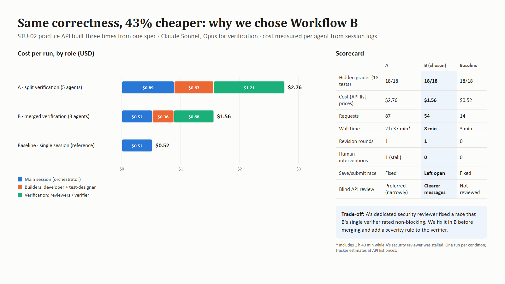

# Reflections

Concrete examples backed by results in `workflow/experiments/`, `workflow/security/` and `logs/`. Sections not yet backed by an experiment are marked as still to do.

## Multi-Agent SE

### The experiment: one feature, three ways of working
We built the same feature, the server-side core of STU-02 (practice attempts, with answers released only after whole-set submission), from one approved spec and one start commit:

- **Variant A, split verification (4 agents plus the orchestrator):** developer and test-designer in parallel (the test-designer in its own git worktree, so neither sees the other's files), then a reviewer (Sonnet, read-only) and a separate security-reviewer (Opus).
- **Variant B, merged verification (3 agents plus the orchestrator):** the same build step, then one verifier (Opus, read-only) doing code, docs and security review together.
- **Baseline, single session:** no subagents. A reference only, because the assignment requires multi-agent SE.

**How the agents are counted.** The spec-writer was not part of the comparison: the spec and plan were written and approved once and given identically to every run. The orchestrator is the main session that coordinates the run. Older records (the resource log, `workflow/experiments/results/`, the comparison image below and the earlier deck) label A "5 agents" and B "3 agents"; that counts the orchestrator for A and not for B. Like for like, A has the orchestrator plus four agents and B the orchestrator plus three, so the real difference is one agent: A has two reviewers where B has one verifier. The recorded cost by agent in `workflow/experiments/stu02/fair/README.md` lists exactly these agents.

### The fair comparison
All three ran on the same day from the same commit, with the same model, effort and prompt template, each in a fresh session and worktree, the workflow being the only difference. Correctness was graded with an 18-test hidden suite. An independent agent that never saw any implementation designed 115 edge cases (75 contract, 40 robustness) and a reference implementation with 62 planted bugs, all from the spec alone. A blind reviewer compared the three APIs as a frontend developer would.

| | A | B | Baseline |
|---|---|---|---|
| Hidden grader | 18/18 | 18/18 | 18/18 |
| Cost | 1.36 USD | 1.46 USD | 0.45 USD |
| Wall time | 6.3 min | 7.8 min | 2.2 min |
| Revision rounds | 0 | 1 | 0 |
| Independent edge cases | 107/115 | 107/115 | 107/115 |
| Planted bugs caught by own tests | 62/62 | 62/62 | 62/62 |
| Blind API review | 3rd | 1st | 2nd |

**Why we chose B, against our own tie-break.** Our pre-set rule qualifies runs on the grader with no leakage, then picks the cheapest unless within 15%, then prefers fewer revision rounds. A and B were within 7%, A needed no revision round and B needed one, so the rule pointed to A. We then looked at what that round was: B's verifier had blocked the run until the out-of-date developer guide was fixed. That round cost about 0.21 USD, the whole cost difference (without it B would have been about 8% cheaper than A). A's reviewer saw the same stale guide, called it non-blocking, and A shipped without fixing it. The rule was rewarding A for skipping a fix the assignment requires. On what was delivered, B was at least as good: accurate docs, first place in the blind API review (the only run following the documented check order), and the same tests and edge-case results. We chose B for the long run and recorded the override (`workflow/experiments/results/stu02-decision.md`).

### When a pre-set metric rewards the wrong behaviour
Fixing the decision rule before the runs protected us from picking a favourite after the fact, which was the point. But "fewer revision rounds" assumes a round means a mistake was made, when here it meant a reviewer did more of its job. A proxy metric can be gamed even by an honest process. Next time we will compare what each run delivered (open defects, docs accuracy) before counting rounds, and treat an override as legitimate only when it is justified by evidence and written down before acting on it.

### How an unfair setup nearly decided for us
Our first comparison chose B because A cost 2.76 USD against B's 1.56 USD. Two problems produced that gap. First, Claude Code loads subagent definitions from the main project folder, not from the run's worktree, and the main folder held older agent files during both runs. We found this only by reading the subagent logs, and B's verifier had silently run as a general-purpose agent. Second, A's security-reviewer stalled for 1 h 40 min after one of its own tests failed, until a human nudged it, and the gap expired the orchestrator's prompt cache. Re-running A alone with the correct definitions cost 1.58 USD, the same as B, and only the fair re-run of all three gave a comparison we could trust. Lessons: verify which instructions agents actually received, not which you wrote; keep every condition's environment identical; and treat a single striking cost number with suspicion until it is reproduced.

### Coordination design and how we verified it
The pattern is generator-verifier with an independent test designer working from a fixed HTTP contract. A two-endpoint pilot (1.46 USD) before the real runs exposed five process defects, all fixed: the test-designer's worktree started from a branch without the spec; a reviewer was told both "read-only" and "write to notes.md"; an agent staged another agent's file with `git add -A`; an unverifiable "lint green" trigger; and the security-reviewer creating its own log file. We verified adherence from evidence rather than reports: git timestamps (tests and code committed independently, seconds apart), the tracker's per-agent cost breakdown, and the subagent logs.

### What every reviewer missed
All three fair runs shipped the same save/submit race: a save that has passed its "still in progress" check can land after a concurrent submit and change a submitted attempt (in A it then failed with a 500). Both A's security-reviewer and B's verifier saw it and rated it non-blocking, on the grounds that the store is an in-memory placeholder. Having a dedicated reviewer was not enough; the severity call was the weak point. We fixed the race in the merged code and gave the verifier of our chosen workflow an explicit severity rule: any request sequence, including concurrent requests, that breaks an acceptance criterion, leaks data or lets one user act as another is blocking, whatever the spec says or the store is.

### Idle, blocked and overloaded agents; overhead
The only blocked agent was the stalled security-reviewer in the original A run. In the fair runs nothing stalled. Coordination still costs: the orchestrator was 28% of A's cost and 38% of B's, and B's orchestrator and developer made more round trips (62 requests against A's 47), which is why B, with fewer agents, cost slightly more.

### Conflicts between agents
In the original A run the orchestrator told the security-reviewer not to touch `src/`, contradicting its definition, so its adversarial tests were never committed. In two runs a test written by an agent asserted the opposite of a later team decision (that padded student ids are different students), and the independent reviewer read the silent spec the same strict way. When the spec is silent, agents fill the gap differently. The fix is to make such choices explicit in the spec template, which now asks for input normalisation and concurrency.

### Did multi-agent coordination outweigh its costs?
On this feature, no. The single session matched both variants on correctness, edge cases and planted bugs at a third of the cost, and ranked between them in the API review. The benefits we hoped for (independent tests catching more, a security specialist catching what an author misses) did not show up as measurable differences. An earlier unfair run suggested they might, which is exactly why we re-ran it. Our honest conclusion is that multi-agent coordination pays only when the work outgrows one session's attention: larger features, open-ended AI behaviour, or security-critical logic where an explicit severity rule forces a second look. For small, precisely specified features and for fixes and docs, a single session is the better trade, and `workflow/coordination.md` allows it.

### Applying Variant B to the frontend
The STU-02 frontend run used the approved API contract, a developer and an independent test-designer in a separate worktree, followed by the merged verifier. The resource log reports about **5.49 USD**, partial when measured, for the build and **two fix rounds**; this is tracker list-price cost, not a billing figure. It is about 3.8 times the backend fair B run's 1.46 USD, but the tasks differ in size, so this is not a controlled workflow comparison.

The first verification found two blocking defects: a missing attempt at the results step did not recover, and the all-roles route test timed out under default parallel workers. Fixes added results-step recovery and split the route test. Review also prompted locked answers during finish-only retries, response-shape checks and CI/documentation improvements. In round 2, requested by the user, the developer fixed five non-blocking items: unlocking after a server 422, tests for locked and wrong-shaped response states, broader bundle scanning with a positive control, removal of `test.slow()`, and accurate retry wording in the User Guide. The verifier passed at `d1f8392`, recording 62 mocked tests twice, 60 backend tests and one real-backend test.

This run shows concrete value from checking recovery paths and normal test settings, beyond the happy path. It also exposed contract gaps: UI wording was added during the build, and the planned `api/` folder became `services/` because the dev server's module URLs interfered with an existing request check. Two developer reports failed to reach the orchestrator, so the verifier's own re-runs supplied the evidence. Future plans should fix test-relevant UI wording before the parallel build and keep handoffs in durable records.

A later small, single-session wrong-answer colour fix added three tests, bringing the recorded mocked suite to 65; it was included in merged PR 5 but was not independently reviewed by the verifier. Dark-mode colours still need an eye check. The source records are `workflow/notes.md`, `workflow/experiments/resource-log.md` and `logs/Stu02FrontendSpecSummary.md`; the documentation reconciliation did not re-run these tests.

### SHR-01 (authentication): what the build showed
SHR-01 was built with Variant B: a developer and an independent test-designer in parallel from the approved spec, then a verifier, with at most two correction rounds. Evidence: `logs/Shr01SpecSession.md`, `logs/Shr01BuildSession.md`, `workflow/security/test-log.md` and `workflow/notes.md`.

- **Tests written only from the spec miss what the spec does not name.** The spec said login counters are updated under a lock, yet no test sent parallel requests. The verifier found that parallel wrong-password logins could all pass the limit check before any failure was recorded (a bypass of the brute-force limit). Concurrency has to be a written acceptance criterion for security features.
- **A fix can create a new defect, and a control test catches it.** The independent test-designer added three failing concurrency tests plus one that passed on the old code (parallel correct logins must not be throttled). The first fix made that control test fail, because in-flight attempts were counted as failures. A second round (per-key serialisation) passed all 23 rate-limit tests.
- **Most integration failures were unspecified UI details, not logic.** Loading text, "Create account" as a tab versus a button, logout failure behaviour, the `/api/auth/me` timeout and a lone-surrogate password all came out at integration. The first merged Playwright runs had 19 to 26 failures; after one developer round and two test-side edits the full run was 216 of 217. The STU-02 build had the same lesson (UI wording was not in its spec).
- **Independence has a cost, and it worked as designed.** The test-designer could not see selectors, so mismatches appeared late. In return the tests were not shaped to fit the code, and the backend suite was 659 passed and 7 failed on its first merged run (six test-side problems, one docs gap), 666 passed after those fixes and 670 passed on the final code.
- **Reviews separate "ran" from "read".** The verifier could not run the backend tests in round 1 because its test database had expired, said so, and gave findings from reading only. Round 2 added a database-free probe (200 threads) that confirmed the limiter fix.
- **Open risks were recorded, not hidden.** After the two rounds the verifier left five non-blocking notes (a denial-of-service path from serialising logins per IP, partial limiter memory cleanup, dead code, a stale guide line, deployment notes). They are in the threat model and security log for the team.
### ADM-01 experiment: where the tokens go, and which workflow changes cut them (Nov 2026)
Our own question was that one multi-agent feature build takes too long and too many tokens. We built the same ADM-01 backend slice from one frozen spec four times: A (unchanged Variant B), H1 (context allowlist for the agents), H2 (verifier gets a labelled checklist and diff summary) and H3 (Haiku instead of Sonnet for developer and test-designer). A single-session control (C) was planned but dropped to save budget. Because A ran without a test database, we later re-ran the baseline once more with a database (A2, see "Follow-up: baseline re-run A2" below), which changes the reading of H1 and H2. Costs come from the token tracker (list prices, not billed). Quality was a frozen 153-test suite on real Postgres plus a blind verifier review per arm. Details: `workflow/experiments/adm01/results/review-pack.md`.

**How the test was run (so it can be repeated or checked).**
- *Setup:* one spec, plan and task list for ADM-01 (backend only), written once by the spec-writer and frozen at tag `adm01-start`. Four arms each ran in a fresh Claude Code session on their own git worktree, with the same prompt and the same Variant B coordination (developer and test-designer in parallel, then verifier, at most 2 revision rounds). The only difference between arms was the one change listed above. Arms ran in a fixed order, at least 65 minutes apart, so the prompt cache was cold at each start.
- *Cost:* measured afterwards from the Claude session logs with our token tracker (`invocations-from-logs`), per agent role, at list prices (not billed). Per-arm reports are in `workflow/usage/runs/2026-11-05-ADM01-<arm>/`. The cap per H arm was 1.5 x A's cost (2.536 USD).
- *Q1, objective quality:* a frozen suite of 153 tests (`workflow/experiments/adm01/frozen-suite/`), written by an independent test-designer from the spec only, run against each arm on a throwaway Postgres 16. Pass means 153 of 153 with none skipped.
- *Q2, blind review:* each arm's code was checked out as x1 to x4 (the mapping to arms was kept in a key file and revealed after grading) and reviewed once by the read-only verifier, which checks every acceptance criterion, security and code quality. Pass means no blocking defect. The reviewers read code and did not run tests.
- *Decision rule:* adopt a change only if the arm passed Q1 and Q2, finished within its cap and without help, and cost at least 10% less than A.
- *Where the evidence is:* the files named in this section (results pack, token reports, frozen suite, grading tools, state) are on the branch `exp/adm01-coord`, not on `master`.
- *Not kept in the repo:* the arm branches (code) are not pushed, to keep the repository small; the numbers and defect descriptions above are the record. The grading script and comparison tool are in `workflow/experiments/adm01/tools/`.

**Reflection question 1: which types of tasks consume the most tokens in your workflow, and did you reduce them?**
- **Test-designer work is the largest share.** In the baseline A ($1.69, 56 requests) the test-designer cost $0.68 (40%), developer $0.42 (25%), verifier $0.34 (20%) and orchestrator $0.25 (15%). The H arms show the same ordering: the test-designer is about 40% of cost in H1 and H2 and 29% in H3. The test-designer runs twice or more (the second run re-reads a context of 77-90k tokens), and in every arm its later runs had the largest contexts.
- **Context re-reading dominates, not generation.** Cache hit ratios were 0.92-0.95 per arm, so most input is re-read context. Reasoning was 18% of tokens in A, 13% in H1, 16% in H2 and 50% in H3.
- **We did not reduce usage (first reading, superseded by A2 below).** Against A, all three changes cost more: H1 $2.60 (+54%), H2 $2.62 (+55%), H3 $3.02 (+78%). Against the re-run baseline A2 ($2.60), H1 and H2 are within 1% and only H3 is higher (+16%). Each H arm also used a revision round, A used none, and the H arms started their own Postgres to run tests, which A never did. We cannot say which of these caused the extra cost, because each variant ran once and the database confound was not controlled.
- **Cheaper model, higher bill.** H3 used Haiku for developer and test-designer; their requests carried 120-190k tokens of context and 50% of its tokens were reasoning, and its developer cost $0.94 against $0.42 in A. So a lower price per token did not give a lower total here. One run is an anecdote, so we draw only this narrow conclusion for ADM-01.
- **Honest limits.** All three H arms went over the pre-set cost cap (1.5 x A), so under our rule none qualified. A itself failed one frozen test (it sent no `Cache-Control: no-store` header). Verifier cost for the blind review is excluded from arm totals.

**Follow-up: baseline re-run A2 (9 Nov 2026).** Arm A had no test database, so its own ADM-01 tests were skipped (they skip without `TEA01_TEST_DATABASE_URL`) and its cost left out any test-and-fix loop. We re-ran the baseline once as A2: same tag `adm01-start`, same spec, plan, tasks, agent files and prompt as the other arms, branch `exp/adm01-A2`, a throwaway Postgres 16 provided through that variable. Cost is measured with the same tracker; report: `workflow/usage/runs/2026-11-09-ADM01-A2/report-v2.md`.
- *Result:* A2 cost $2.604 (7 invocations, 113 requests, one revision round), against $1.691 for A (56 requests, none). It passed the frozen suite 153 of 153 (A: 152) and the blind review as x5 with no blocking defect and four non-blocking notes.
- *Reading against A2:* H1 $2.599 (-0.2%), H2 $2.618 (+0.5%), H3 $3.016 (+15.8%). Under the 10% rule H1 and H2 are inconclusive (no measurable effect), not worse; H3 stays rejected. No hypothesis is adopted.
- *Cost split in A2:* developer 34%, test-designer 33%, verifier 18%, orchestrator 15%. The test-designer is no longer clearly the largest share once the developer has a test-and-fix loop.
- *Limits:* one run. A2 was started as a separate session from a coordinator session, so it inherited that session's model and permission mode and received the database variable from a local settings file; the original arms ran in VS Code with a human answering permission prompts. Its first request read 45,866 tokens from cache, so the cold-cache control was not perfect. Its elapsed time (about 52 minutes) is mostly test runs and is not comparable. The A2 session did not run the full backend suite (`test_shr01_access.py` hung and was not diagnosed); the 328-test result and the frozen suite cover ADM-01 and neighbouring areas only. The blind reviewer read code and did not run tests.
- *What we take from it:* the first comparison over-stated the effect of H1 and H2; checking the baseline's setup before accepting a result changed two verdicts from "worse" to "no effect". The A2 evidence is on `exp/adm01-A2` and `exp/adm01-coord`, not `master`.

**Reflection question 2: did the benefits of multi-agent coordination outweigh the costs, and when should it be used?**
- **What the extra agents bought.** The blind verifier found real issues the author's own tests missed: in H2, a generation request could record `requested` with no outcome event if a file read failed (no test covered it). The frozen suite found A's missing header, which A's own run did not catch (its ADM-01 tests never ran, as it had no database). The two checks caught different defects, so neither replaces the other.
- **What it cost.** Every arm needed 56-100 requests and, for the H arms, 1 revision round, for a backend slice that is small. The orchestrator, handoffs and repeated test-designer runs are overhead that a single agent would not pay.
- **We could not settle the rest.** The single-agent control was not run, so we have no measured cost for doing the same feature in one session. We therefore cannot say that multi-agent was worth its cost for a feature this size; we can only say that it caught defects. The planned test (C vs A) remains open.
- **Rule of thumb we would use next.** Keep independent verification for features with auth, user data or AI, where a missed defect is expensive; for small, well-specified backend slices, try a single session with the same frozen tests and a blind review at the end, and compare cost.

**Process lessons from running it.**
- A pre-set quality suite can itself be wrong. Our AC11 test flagged `dict.update` as a database write in all arms, so every arm looked like it failed until we fixed the test and re-graded. The URL scheme for the test database (`postgresql+psycopg://`) also silently caused 503s that looked like 143 failures.
- Give every arm the same environment. The H arms ran with a real database and A did not, which makes the cost comparison unfair.
- Do not use revision rounds as a quality proxy: H1 and H3 needed one and passed; A needed none and failed one test.

### STU-03: independent agents left the same resource assumption untested

The ADM-06 verifier recorded **1,169 backend tests passing**, yet the existing 30-request companion test later returned 503 in CI. A required post-AI session check opened another database connection while the initial authentication transaction still held one. The security checks were individually valid, but their combined connection ownership could exhaust the pool. This was an implementation and in-scope review miss, rather than an ambiguous API contract. [Earlier verification](../logs/Adm06Implementation.md), [failure investigation](../logs/Stu03ConcurrencyPoolFix.md).

**The useful change was to constrain capacity, not add more threads.** Two new tests used a one-connection pool: both failed before the fix (`f66d647`). Releasing the initial connection (`6e8f63a`) made them pass while preserving the post-AI security check. They also require **zero connections held during the model call**. The original concurrency test then passed 20 repetitions (600 requests), and the full suite passed 1,171 tests. Independent authorship had not challenged this resource assumption; the bounded-pool test did. Future changes that add a second session should test connection ownership across the existing request path. [Regression assertions](../src/backend/tests/test_stu03_connection_lifetime.py), [results and limits](../logs/Stu03ConcurrencyPoolFix.md).

## Context Engineering and Resource-aware Use

### Measured observations so far
- **Model switching invalidates the cache.** After switching one long session from Sonnet to Opus, 5 requests cost 2.69 USD, mostly from rewriting about 280,000 tokens of context at the Opus cache-write price. Keep one model per session; start a new session for a different model.
- **Long-lived coordinating sessions are the hidden cost.** The session that set up, ran and analysed the experiment cost several times more than all experiment runs together, because every turn re-reads a long context. Short, focused sessions with handoff notes are cheaper.
- **Cache reads dominate volume; output and cache writes dominate cost.** Every run read millions of cached tokens cheaply; the expensive parts were output and cache writes, and a stall that lets the cache expire forces an expensive rewrite.
- **Reasoning share.** Reasoning was 10% of output in fair A, 6% in fair B and 6% in the fair baseline; the Opus security-reviewer spent 23% of its output on reasoning.
- **Context organisation decides which instructions are followed.** Agents followed the definitions loaded from the main folder, not the newer files in their own worktree; orchestrators followed the `coordination.md` they read directly.
- **Measure, don't estimate.** Every run wrote token estimates into its resource log, and none matched the tracker's measured figures.

### Sizing the AI companion's limits (STU-03 experiments, 30 Oct 2026)
We measured the SoC LLM before writing the STU-03 spec instead of guessing limits: 347 live chat calls in seven phases, costing $0.066 in total by dashboard differences (details and tables in `workflow/experiments/stu03-caps/RESULTS.md`).
- **The answer-length instruction matters more than the cap.** A short-answer instruction ("at most 3 short sentences, no markdown") cut explain cost per call from about $0.0004 to $0.0002 and let a cap of 150 tokens work where the standard instruction needed 400. Tuning the cap alone would have missed this.
- **A deterministic usefulness rule made the comparison possible,** but it was only a proxy and we had to relax it once after seeing 24 good hints fail on a missing question mark. We report both versions, which shows that rules chosen before the data can still be wrong.
- **Prompts are not security controls.** Under attack, both instruction variants leaked the answer or narrowed it down in roughly a third to a half of hint attempts, one obeyed a fake "SYSTEM" line, and a pasted practice question was answered in full. This supports enforcing answer release on the server, and means the cheaper instruction must not be mistaken for a safer one.
- **Our own leak check missed most of what a human reader found** (3 of 6 in the last phase). Automated checks need to be tested against reading the replies.
- **Fitted per-token prices predicted the next phase's cost almost exactly** (0.0513 predicted, 0.0513 measured), so a small calibration run lets us budget live calls before making them.
- **The cheapest design combines three levers, in this order of size:** a short-answer instruction (cuts a call by 22% to 57%), then less history (each 2 messages add 4% to 16% to a call and did not make replies more useful in our tests), then the output cap, which is only a ceiling and changes cost little once it clears the natural reply length. Against our first guess (standard instruction, 4 history messages, caps up to 400) the recommended setup, which keeps 4 history messages for usefulness to students (the user's decision, not a measured benefit), is about 22%, 49% and 31% cheaper for hints, explanations and help.
- **How the caps were chosen:** from a full grid of 270 calls (mode x output cap x instruction x history, in `workflow/experiments/stu03-caps/results/phase6-grid.md`). The cap is the larger of the smallest cap where every reply passed and about twice the longest finished reply under the short-answer instruction, giving hint 100, explain 200 and help 150. Each cell holds only 3 replies, so we read trends and pooled rows, not single cells.
- Limits: small samples, one model alias, a proxy rule, no real rate-limit or concurrency tests, and test questions too independent to show whether history helps follow-up questions.

### Still to do
- System prompts and skills for the agents; upfront versus retrieve-on-demand context; when more context hurt.
- What belongs in notes and handoff documents beyond the handoff template.
- Model choice per task beyond the Sonnet/Opus split used here.
- Other token-monitoring and reduction approaches, and the most token-hungry task types once more features are built.

### SHR-01: how the lesson changed our spec writing
The integration failures came from UI states that no spec named (loading text, a button versus a tab, logout failure behaviour, the `/api/auth/me` timeout). The independent test-designer works from the spec and cannot see the code, so a state that is not written down becomes a guess. The change, made after the slice and tracked in git: the spec template has a "UI states and copy" table (controls and exact labels, loading, success, empty, each failure with its exact message, what stays after a failed action, refresh, Back, expired session, backend down, the longest wait) and the plan template has a "UI contract" (accessible role and name for every control tests use). The spec-writer agent definition and `AGENTS.md` now require both for any feature with a screen. We will check the effect on the next feature by counting UI-detail failures at first integration (SHR-01: 19 to 26 failing browser tests).

### SHR-01: resource use (what was costly, what helped)
- **Full-suite reruns were the biggest avoidable cost.** The backend suite takes 17 to 29 minutes because every test builds its own isolated database schema, runs the account seed and hashes passwords with scrypt. It was run in full several times (test-designer's RED run, developer's runs, three of mine). Cheaper setup (seed once per session, lower hash cost in tests) and scoped reruns would have saved time and usage.
- **Overlapping runs gave misleading results.** A Playwright run alongside the backend suite had 19 failures (many timeouts), but a quiet rerun had 26, so load was not the main cause and the overlap only muddied the picture. Run browser and backend suites one at a time.
- **Scoped verification and reuse paid off.** Rounds used a scoped verifier (review plus targeted test reruns instead of the whole suite), and resumed agents with `SendMessage` kept their context instead of paying for a cold start. The usage limit (69% at one point) shaped decisions: consolidating docs and logs into one final pass, and deferring the verifier until the failures were understood.
- **Measured with the token tracker** (`workflow/experiments/results/shr01.csv`, 4 Nov 2026, list prices, not billed): 641 requests and about $30.24 for the whole slice. Test-designer $11.14 (37%), main session $9.61 (32%), developer $7.12 (24%), verifier $1.39 (5%), spec-writer $0.98 (3%). By kind, cache writes were $13.5 (45%), cache reads $10.9 (36%) and output $5.8 (19%): most of the cost is loading and re-reading context, not generating text. This replaces the harness estimates written earlier, which used different units.
- **Scoping helped time more than tokens.** The initial developer build cost $5.17, the frontend fix round $1.95. The two verifier rounds cost the same ($0.69, then $0.70 scoped), so scoping the verifier saved no tokens, but a scoped test rerun took about 2.5 minutes against about 19 for the full backend suite. We never ran an unscoped copy of the same task, so there is no controlled before/after here.
- **Agent bookkeeping cost time.** One agent committed to the wrong branch, and agents left servers and temporary databases running because process kills were denied. Define branch ownership and cleanup before agents start.

### STU-01: did the UI-states template help? (first evidence)
The template change (a "UI states and copy" table in the spec and a "UI contract" in the plan) was tried on STU-01. On the first integration run 36 of 101 STU-01 browser tests failed (11.2% of the whole 321-test suite, against 8.8% to 12.0% of 217 for SHR-01), so the amount of rework did not drop. What changed is the kind: none of the 36 were mismatches of copy, labels, accessible names or control types, the class that dominated SHR-01. 32 came from one behaviour nobody had specified (React StrictMode sends every page's GET twice in development), one from an effect that refetched on a 401, and three from test or spec gaps (wrong-role navigation, history push versus replace). The developer's fix for the StrictMode problem then introduced a blocking defect (a shared in-flight GET could show one user's data to the next), which the verifier found and reproduced; that is the second place where a quick fix needed independent review. Details: `workflow/experiments/results/stu01-first-run.md`.

Reading, with limits: this is one feature against one feature, of different size and screens, with failures classified by the agent that wrote the code, so it is consistent with the template helping on copy and labels but is not evidence that it helps in general. SHR-01's own per-test classification was not kept, so the comparison is qualitative. Template additions made afterwards (user-approved): the templates and the spec-writer rule now require, per screen, requests sent per load and per retry, what a wrong-role user sees, and whether each link pushes or replaces history, as labelled entries. Enforcement: a separate spec checker (CHK-01, own branch and PR) reads the specs for those labelled entries and an unfilled UI table. When it was run on the approved STU-01 spec it reported 11 findings (four missing labelled items in the plan, a missing concurrency item, a missing 'Open questions' section, an empty table row, a placeholder), all fixed by wording the facts already built; so a script can check that the items are present on the day a spec is written, but it cannot check that what they say is true or sensible, which stays with the verifier and with the first-run failure counts.

### STU-01: resource use
- Tracker (list prices, matched by branch): 448 requests, about $14.37; test-designer 5.12, main session 3.71, developer 2.42, verifier 2.29, spec-writer 0.82. Worktree branches and unmatched sessions are not included, so this is a floor. The cost comparison with SHR-01 was dropped.
- The full backend suite again took 28 to 35 minutes; running it together with Playwright, or with another test run, caused false timeouts, so reruns were done one after the other.
- A setup mistake (the temporary Postgres URL needed the `postgresql+psycopg://` scheme) made the first full backend run fail almost everything and cost about 25 minutes before it was diagnosed from the first failing test. Check the first failing test early instead of waiting for the full run.
- Moving the verification to a "cloud" session did not work as intended: the session started locally. Do not plan unattended work on it.

### STU-04: second test of the UI-states template (progress dashboard)
STU-04 (saved practice attempts, a documented weak-topic rule, a Progress page and real figures on the Overview) was the second feature written with the "UI states and copy" table. On the first merged run 19 of 423 browser tests failed (4.5% of the suite, against 11.2% for STU-01 and 8.8% to 12.0% for SHR-01). The biggest STU-01 class, 32 failures from React StrictMode sending every GET twice, did not appear: the spec table now names requests per load and per retry. Copy was not perfect: three failures came from the Overview reusing a long error message where the spec gave a shorter exact one. This time an independent verifier classified the failures: 7 test bugs (strict-mode duplicate text, a body-wide lookup matching the shell's pill), 6 code bugs, 3 spec gaps, 2 load flakes and 1 stale old test. Backend: 5 first-run failures, 4 of them stale tests, and one real defect (a NUL byte in an attempt id returned 503 instead of 404) that only the verifier's own probe found.

A fix to session behaviour again introduced the next failure: keying the pages by sign-in status remounted them, so a signed-in 401 sent a second request. That is the same class of regression as STU-01's shared in-flight GET, and the rule we took from it is to re-run every test for a table entry after a fix to request or session behaviour. The cap of two verifier rounds was exceeded once (a narrow third round, authorised by the user). Merging master gave two Alembic heads that git did not flag, for the third feature in a row; a CI check that fails on more than one head is still not in place.

Resource use: the orchestrator did not create the run manifest the workflow asks for, so there is no tracker run and no measured cost for STU-04. The harness reported about 167k tokens for the spec-writer, 175k for the test-designer, 191k for the developer and 231k for the verifier (cumulative per resumed agent, main session not included). Limits: two features of different size, a suite that grew from 321 to 423 tests, and a different classifier (the developer for STU-01, the verifier for STU-04), so this is an observation and not evidence that the template helps in general.

### STU-02 on published sets: a shared provider, and servers that mislead the tests
This slice made the student's practice run on teacher-published sets through one shared set provider (course membership, one uniform not-found error), with a picker page and a set page. The first valid browser run failed 5 of 522 tests (1.0%), none of them copy, label or accessible-name mismatches, and one backend gap in the spec (it named no code for a non-string choice value). Two earlier runs, with 150 and 151 failures, were invalid: Playwright reuses a server already listening on port 5173, and a dev server and backend from another worktree answered instead of this branch's code. Check what is listening on the ports before a browser run, and use a private port for agents.

The verifier failed round 1 with two blocking defects that the suites did not catch and passed round 2. The plan edited the CI workflow for the new seed step but did not list the answer-key scan that read the deleted fixture, so every CI run would have failed. The companion rejected a submitted attempt when the URL spelled the set id differently (uppercase or braces), because its new consistency check compared exact text while the spec promised any accepted spelling finds the same set. The slice also edited the teacher's files (two student routes, the seed and one test), which had to be briefed to the teacher before merge. Resource use, from the tracker rebuilt from session logs: about 26.9 USD at list price over 523 requests and 14 invocations including the orchestrator (not billed).

### STU-05 and STU-06: a verification slice, and what only a person or the verifier found
Before writing any spec we read the admin side. ADM-02 (merged) already shipped the student form flow and PR 31 (ADM-04) the Messages inbox and a combined unread badge, so the slice built no new route, table or endpoint. It checked every acceptance criterion against that behaviour, added tests only for the gaps (access by a second student, concurrent mark-read and submit, the badge, one section failing, wrong role), showed `From: Administrator` because the message data has no sender, and recorded that forms go to named recipients, not student groups. A merge conflict with master was real: PR 31's badge broke our STU-02 picker request-count test, and master fixed it the same way, so we took master's version.

After the user tried the app, four further criteria were added (AC15 to AC18): the question prompt shown once and larger instead of twice (once on the card border and once as a floating label), linear-scale labels at the two ends, a red marker on missed required questions, and a padded completed page. The ADM-02 contract had fixed the legend and the input label, which is what caused the double prompt: the spec fixed names and copy exactly but not visual hierarchy. Tests came first (26 of 31 new form tests failed on the old code, as intended). Verifier round 1 failed on two real defects that no test could see because Playwright fills a field in one step: after a failed submit, focus jumped to the next question on every keystroke, so text could land in the wrong answer, and a marked field had no visible focus cue. Round 2 passed. Two further defects were introduced and caught while fixing: a hover rule hid the red marker (caught by the existing AC17 tests) and a grid made the action buttons full width (caught by the verifier).

First-run failures of the feature's own new tests: 1 of 19 for the slice (the sender label that did not yet exist) and 2 of 30 for the form changes, both the test-designer reading the spec too strictly (the page alert persisting after an autosave; a label edge aligned to a radio box, which was in fact a real 9px misalignment). The full local suite on the final code was 742 of 752; the 10 failures were outside our files and known or flaky. All 6 GitHub checks passed on PR 32.

Resource use, from the tracker: about 13.6 USD at list price and about 45.8M tokens over 10 invocations, counting the orchestrator once (the orchestrator is 43% of the cost, the verifier 27%). Because the tracker reads a whole session log, a second run in one session needed an orchestrator window spanning the session, so its two reports double-count run 1's orchestrator (about 2.84 USD). Costs are list-price estimates, not billed.

Reading across the features written without and with the template (SHR-01, then STU-01, STU-04 and STU-02 on published sets; limits: one feature each, different sizes, different classifiers, and STU-05/06 was mostly verification, so its low failure rate says little about the template): the first-run browser failure share was 8.8% to 12.0% for SHR-01 and 11.2% for STU-01, and 4.5% for STU-04 and 1.0% for STU-02 on published sets, and what the failures were about changed from copy and labels (SHR-01) to request counts (STU-01) to test bugs (STU-04) to behaviour on interaction (STU-05/06). This is consistent with the template helping on copy and request counts, not proof. What the table did not cover, and the verifier found by reading the code, was interaction behaviour: focus while typing, and hover and focus combinations of a red marker. We would add to the UI contract an entry for focus and typing after a failed submit.

### CHK-01: enforcing the spec-writer rules with a script (what it caught, what it cannot)
The UI-states table and UI contract were first only text in the templates and the spec-writer role, so nothing stopped a spec from skipping them. CHK-01 (`workflow/tools/speccheck/`, PR 19) reads each spec folder against one rule table (`registry.py`): template sections, an acceptance-criteria item, a role tag in `tasks.md`, no TBD/TODO/???, and for a spec with a screen the table, the contract and nine labelled items (requests per load and retry, wrong role, link push or replace, refresh, back and forward, expired session, backend down, longest wait, no generic failure), plus two security items (concurrent requests, normalisation). A feature without a screen declares `No screen: reason`. Older specs are grandfathered in a visible waiver file, so CI stays green without hiding them: with the waivers removed, 12 of the 13 specs then in `master` failed (201 findings, mostly missing labelled items and sections).
- **First real result:** run on the approved STU-01 spec before its merge, the checker gave 11 findings (reported by the orchestrating session). They were fixed by rewording the spec and plan to the eleven labels, after which STU-01 passes with no waiver. So the rule did bite on a new spec, and the labels in the templates, the spec-writer text and the checker now have to stay identical; that coupling is the main upkeep cost.
- **Limits, stated in the tool's README as "Verifier only":** the checker proves a thing was written down, not that it is true or sensible. A filler line passes; an empty heading or bold label can take the next item's text; whether acceptance criteria match the user stories or the contract is complete stays with the verifier. We have no evidence yet that it reduces first-run failures; the measure is the next feature's first-run classification (UI-detail, other contract, logic bug, test bug), compared with SHR-01 and STU-01.
- **What independent review caught:** the verifier rejected two rounds. Round 1 found a heading pattern whose matching time grows with the square of the line length, so one crafted line could hang the checker and the CI job. Round 2 found that my fix for folder paths followed links, so a folder link named like a new spec but pointing at a waived spec could pass as waived. Both passed the 267 and 286 tests of the time, because no test had that input; a narrow third round passed after the user-approved fix. Lesson: for a gate that reads untrusted text, give the verifier adversarial inputs, and re-review a fix that was made to answer a review.
- **Process cost:** about $9.73 at list prices before the last fix and the deck (189 requests; resource log). The test-designer's 7 first-run failures were wording ambiguities in the plan or over-strict tests, not logic bugs, again showing that the contract must fix output formats exactly.

### Teacher publication: the spec gate and independent runtime checks

The revised TEA-03-publishing specification passed PR19 before code, with exact API/UI text, request budgets and eleven labelled items. Independent backend contracts passed on first source integration (24 new cases; 879 total), but the first full browser run was 365 of 367: an obsolete preview assertion and a real pending-read regression. The strongest reviewer then identified five runtime/contract defects: abandoned-selection GET reuse, uncertain mutation recovery after cancellation, filter selection clearing, HTTP200 retry copy and a warning disappearing during editing. Independent regressions reproduced them before correction. The checker established document completeness; it could not establish these request-lifetime and recovery properties. This is one feature, not evidence of a general improvement over earlier runs. Final correction/review evidence is recorded in logs/TeacherPublishing20261105.md and the security log.

Final result: two correction rounds, strongest read-only PASS at380749e;881backend/377browser passed. Actual rendered inspection then caught a title-counter/topic-label overlap that overflow assertions had missed. A scoped spacing/padding patch passed14focused tests and fresh desktop/mobile light/dark inspection. Runtime state tests and rendered visual checks established different properties; neither replaced independent code/security review. Tracker could not attribute this branch, so token/cost comparisons are unavailable.

> Copied from branch `test/adm03-u63-2026-11-09` (local `exp/multiagent-context-management` lineage). Its evidence files (run report, metrics, conclusion, issue register, retired policy files) are not on this branch; they remain on that branch. ADM-03 is being redone from scratch on `feat/ai-feedback-analysis`, without the failed implementation.

### Context-management attempt before ADM-03 (7 Nov 2026; closed 9 Nov 2026)

**Conclusion: practical failure; adoption rejected.** The experiment is ended independently of the unfinished feature. The user requested restoration of the previous workflow. Historical setup below is retained as evidence, not active instructions. Full postmortem.

**Reflection question: What other approaches have you experimented to monitor and reduce token usage?** We are introducing three context-management changes before developing ADM-03: (1) fresh agent contexts with short, versioned launch packets and durable handoffs; (2) scoped file reads and bounded tool output, retaining full local evidence; (3) completion notifications or tool-side waiting for routine commands instead of progress-only model turns. This is a workflow intervention, not yet a demonstrated token saving. ADM-03 has not been implemented as part of this change.

**Plan recorded before implementation.** First document the launch, reading/output and waiting contracts; add a launch template and extend the existing handoff without duplicating its Next/findings fields. Then align AGENTS.md and Claude role definitions, preserve independent tests and read-only verification, and document concrete command/log handling. Finally check the documentation diff and record this maintenance run. The next, separately authorised ADM-03 feature run will use the updated workflow and supply the after measurements. No feature implementation, tracker algorithm changes, new orchestration framework or relaxed verification gate is included here.

**Evidence and rationale.** The fresh launch excludes inherited conversations; a short packet points to the full approved requirements rather than replacing them. Bounded reads reduce irrelevant material while allowing dependency/security tracing. Tool-side command execution and completion waits avoid repeated model decisions about whether a job has finished. Anthropic reported 84% fewer tokens for context editing in a 100-turn search evaluation ([context management](https://claude.com/resources/articles/context-management)); this does not measure fresh coding subagents. Its [MCP example](https://www.anthropic.com/research/code-execution-with-mcp) demonstrates on-demand tool loading, filtering and loops executed in code, including a 150,000-to-2,000 token tool example; that is not an expected percentage for this project. Our earlier ADM-01 allowlist experiment increased cost, so reducing supplied context is a hypothesis requiring measurement, not a guaranteed saving.

**Changes to inspect.** Shared policy defines fresh launch boundaries, permitted reads, log summaries, waiting and measurement. Launch template records role/phase, source commits, workspace, authoritative paths and unresolved work. Handoff template adds contract/start/result commits, required reads, context mode and evidence references. AGENTS.md, coordination and the four .claude role definitions apply the policy, including a Phase 2 reset guard and review beyond the diff. .gitignore excludes per-run local logs; experiment record and usage guidance define collection. Git diff supplies the exact changed text; no savings are claimed from merely writing these instructions.

**General comparison requested, not a controlled experiment.** Freeze the historical inventory below before ADM-03 begins. Compare one observation per feature (not one per retry), combining non-overlapping spec/build invocations where attribution permits, including orchestrator and revision work. Exclude separate UI redesigns, maintenance, ADM-01 experimental arms and this workflow-edit run from the primary feature average. Keep supplementary reports separate. Report each metric's included feature IDs, sample size and exclusions. Never average partial usage as whole-feature usage or count unmatched legacy zeroes as actual zero. Different feature complexity, models/effort, suite size, cache state, environment and interruptions confound any association. All three changes are introduced together, so the comparison cannot assign savings to an individual approach.

| Previous feature | Frozen source reports under workflow/usage/runs/ | Token baseline eligibility | Published run-window time (not active model time) |
|---|---|---|---|
| ADM-01 | No routine implementation report found in this checkout; experimental arms excluded | unavailable | unavailable |
| ADM-02 | 2026-11-07-ADM02-01/report.md; 2026-11-07-ADM02-02/report.md | unavailable: unmatched logs; build report omits orchestrator/follow-up | build 0:57:35; separate spec 0:05:03; some return bounds |
| ADM-04 | 2026-11-07-ADM04-01/report.md | unavailable: parent/run totals incomplete; matched child observations may be shown separately | 13:16:05, includes interrupted/idle time and bounded returns |
| ADM-05 | 2026-11-06-ADM05-01/report.md | unavailable: parent-only subtotal, missing children; broader discussion window | 0:56:52, includes interrupted/idle time |
| ADM-06 | 2026-11-06-ADM06-01/report.md | unavailable: no matched usage; legacy zeroes are not measured zero use | 0:44:00 |

The unweighted mean of the four published implementation-run windows is **3:58:38 (n=4)**. This is a supplementary historical wall-time reference, not a complete spec-to-finish or active-work baseline: windows differ in scope and include interruptions. The complete-feature token average is currently **unavailable (n=0 eligible features)**. Recover reliable historical attribution if possible before calculating a token percentage; otherwise publish the limitation and retain per-role matched observations as partial evidence. Do not silently replace the primary cohort with UI-only runs.

**Collection for ADM-03.** Create the manifest before work, record every role/start/return/retry and exact source ID, and retain full local logs. Record fresh/resumed/inherited context mode and launch method, model/effort, request count, total tokens, available input/cache/output categories, per-invocation elapsed time, run wall time, interruptions, test outcomes, defects and revision rounds. Where supported, collect first/mean/max request context; existing richer context metrics are Claude-only, so Codex context metrics remain unavailable unless independently verified from provider records. Do not infer context size from total tokens or use character counts as measured tokens. Aggregate repeated invocations per role before comparing roles across features. Use only attribution-complete observations for each average; report differing token/time denominators explicitly.

| Outcome | Historical reference | ADM-03 | Change |
|---|---|---|---|
| Complete-feature total token average | unavailable; n=0 eligible | feature incomplete; observed129,672,868tokens/1063modelrequests across19invocations | unavailable; no primary percentage |
| Supplementary published run-window mean | 3:58:38; n=4, limitations above | observed1day2:22:35 includes three interruptions and user idle | different scope/denominator; no active-time/savings percentage |
| Per-role tokens, requests and summed invocation time | published matched observations only; incomplete cohorts | all11invocations aggregated by role in linked pilot record; models/effort/context/retries included | descriptive observations only; missing historical attribution retained |
| First/mean/max request context | unavailable in current standard Codex reports | unavailable: unsupported by current standard Codex metrics | unavailable |
| Acceptance/security results, defects and revision rounds | different feature scopes/suites | Independent1612backend/817browserPASS; final1probeFAIL/U63. Initial5+correction1three prior findings GREEN, one new blocker after2rounds. Human exception pending | no feature/security PASS or savings conclusion |

Final status9Nov2026: experiment CLOSED as an operational failure, prior workflow to be restored in a separate local commit. ADM-03 remains incomplete withU63; no extra correction was approved or performed. Freeze [19-invocation report](archive/adm03-context-experiment/report.md) and metrics; later application repair gets separate tracking. Conclusion gives evidence, ADM-04 limitations and why both context handling and the pipeline were inefficient. No completed-feature token mean, billed-cost ratio or causal/isolation claim.

#### ADM-03 integration problem caught after approval (7 Nov 2026)

The first fresh developer invocation stopped before application code because the approved analysis contract did not match the existing shared SoC client. ADM-03 requires one provider attempt, full strict JSON validation up to 16 KiB and bounded selected-source context up to 64 KiB. The shared client's defaults instead allow one automatic retry (two attempts), limit input to 12,000 characters and silently strip/truncate replies to 2,000 characters. Its public completion signature has no per-call retry/output controls. Truncation can turn a valid analysis into invalid JSON or conceal trailing invalid output; automatic retries violate the reserved single-attempt behavior. Character and UTF-8 byte limits are also different measures.

The spec-writer's permitted source scope excluded implementation, so it flagged shared-client bindings as unverified assumptions; human approval and a passing structural spec checker did not validate those bindings. The developer's integration stop caught the mismatch before source changes or live provider calls. This is a contract/integration gap, not a runtime test failure or evidence that fresh contexts caused the gap. Independent design also found that provider alias spelling/context structure was unspecified, preventing a deterministic valid mocked analysis without guessing prompt internals.

The response is a fresh, narrow spec clarification: bind the existing shared singleton to a trusted server-owned ADM-03 execution profile, preserve other features' default behavior and shared limiter/observer/configuration, reject oversized output rather than truncate it, and freeze deterministic provider aliases/context for independent tests. Public HTTP/UI policies remain approved; clarification must be committed before implementation resumes. Record the blocked developer invocation, clarification invocation and resumed developer separately in the same run, including tokens/requests/time; do not omit this overhead or count it as an implementation revision round. Resolution and subsequent quality checks are pending at this entry. Evidence: developer gate summary, run metadata.

Ongoing unexpected issues, including resolved setup/contract/documentation surprises, are tracked in the ADM-03 issue register; final closeout must reconcile their outcomes and overhead.

Human closeout decision9Nov2026: extra correction round declined; stopped with current ADM-03 handoff. Standard suites passed, final U63 blocker unresolved, feature incomplete. No further tests/fixes or causal/savings conclusion.

#### Why the context-management pilot failed (concluded 9 Nov 2026)

The stopped ADM-03 run used19invocations versus ADM-04's9 (2.11x), with1,063modelrequests and129,672,868observedtokens. Published matched developer tokens are28,851,124 versus12,578,392(2.29x); verifier14,549,745 versus5,590,270(2.60x). ADM-04's parent/one tester attribution is missing, so its whole-run token/request ratio is unavailable. No primary baseline substitution: frozen historical cohort remains ADM-01/02/04/05/06, complete token mean unavailable(n=0). Different scopes/suites/models/interruptions prevent causal attribution. See the comparison table.

Context handling missed its dominant contributor: the inherited/resumed orchestrator consumed63,241,788tokens(48.77%) over329requests. Scoped source-log audit found115native waits,77timeouts; completion-based waiting still produced repeated model/user-update turns under the host's short-wait/update constraints. Fresh phases reloaded full contracts and rediscovered setup, including repeated missing dotenv and wrong DB port. Bounded reads still truncated. Mandatory fresh launches multiplied cold starts without measured request-context reduction. Of all recordedtokens,127,116,800(98.03%) are cache reads, so these are raw-volume observations, not billed cost; exact wait-only token cost/context sizes remain unavailable.

The multi-agent pipeline also lacked an integration-ready contract and broad early lifecycle coverage. Approval preceded verification that the shared client could meet no-retry/full-JSON requirements, causing a blocked build and new clarification/restart. Fixes covered explicit logout before natural expiry, and timeout cleanup before non-timeout cleanup errors. Port5483overlap disrupted a run; reused artifact output lost the original timeout trace. Environment failures, mixed-snapshot runs, repeated broad regressions and3provider interruptions amplified recovery/report overhead. These are documented execution/planning failures; the spec-writer restriction and required independent checks also existed in the older workflow. Postmortem with direct evidence.

Security review worked as a gate:1612backend/817browser passes did not conceal finalU63. It refused completion after a targeted probe showed502thenpending409. Keep independent tests/worktrees, server safeguards, review, spec approval, revision cap and usage reporting. Reject this combined policy's adoption; restore previous VariantB instructions and stop the experiment. Future authorised old-workflow repair must preserve U63/code/tests/prior rounds and use separate usage records. Closure/rollback costs are separate maintenance. No feature fix or tests run for this request.
