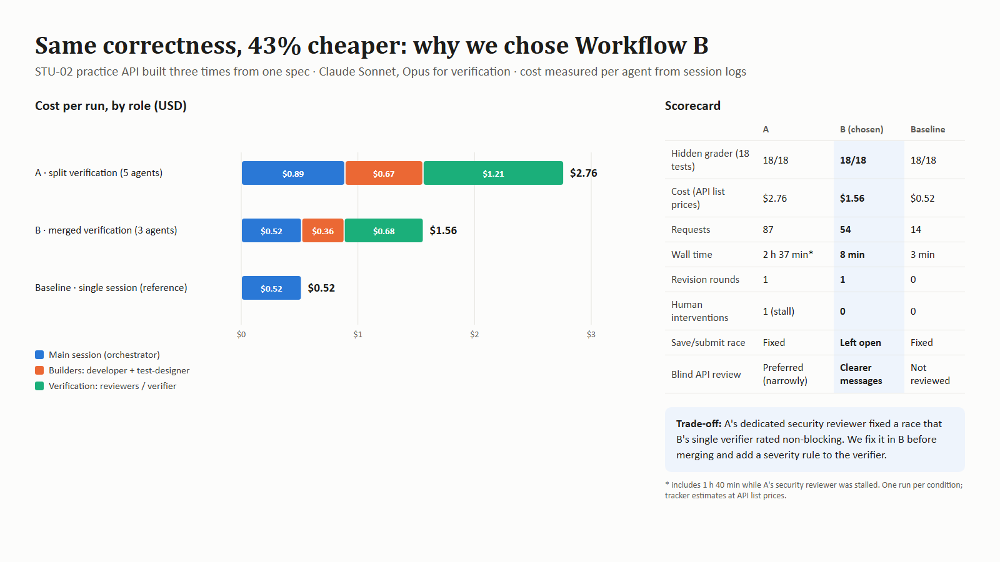

# Reflections

Concrete examples backed by results in `workflow/experiments/`, `workflow/security/` and `logs/`. Sections not yet backed by an experiment are marked as still to do.

## Multi-Agent SE

### The experiment: one feature, three ways of working
We built the same feature, the server-side core of STU-02 (practice attempts, with answers released only after whole-set submission), from one approved spec and one start commit:

- **Variant A, split verification (5 agents):** spec-writer, then developer and test-designer in parallel (the test-designer in its own git worktree, so neither sees the other's files), then a reviewer and a separate security-reviewer (Opus).
- **Variant B, merged verification (3 build agents):** the same build step, then one verifier (Opus) doing code, docs and security review together.
- **Baseline, single session:** no subagents. A reference only, because the assignment requires multi-agent SE.

### The fair comparison
All three ran on the same day from the same commit, with the same model, effort and prompt template, each in a fresh session and worktree, the workflow being the only difference. Correctness was graded with an 18-test hidden suite. An independent agent that never saw any implementation designed 115 edge cases (75 contract, 40 robustness) and a reference implementation with 62 planted bugs, all from the spec alone. A blind reviewer compared the three APIs as a frontend developer would.

| | A | B | Baseline |
|---|---|---|---|
| Hidden grader | 18/18 | 18/18 | 18/18 |
| Cost | 1.36 USD | 1.46 USD | 0.45 USD |
| Wall time | 6.3 min | 7.8 min | 2.2 min |
| Revision rounds | 0 | 1 | 0 |
| Independent edge cases | 107/115 | 107/115 | 107/115 |
| Planted bugs caught by own tests | 62/62 | 62/62 | 62/62 |
| Blind API review | 3rd | 1st | 2nd |

**Why we chose A.** Our pre-set rule qualifies runs on the grader with no leakage, then picks the cheapest unless within 15%, then prefers fewer revision rounds and interventions. A and B were within 7% of each other; A needed no revision round and B needed one, so the rule picked A. Quality was otherwise level: the same edge-case score with the same eight failures, and every planted bug caught by both suites. The blind API review preferred B for following the documented check order. We record that, but the rule does not weigh it.

### How an unfair setup nearly decided for us
Our first comparison chose B because A cost 2.76 USD against B's 1.56 USD. Two problems produced that gap. First, Claude Code loads subagent definitions from the main project folder, not from the run's worktree, and the main folder held older agent files during both runs. We found this only by reading the subagent logs, and B's verifier had silently run as a general-purpose agent. Second, A's security-reviewer stalled for 1 h 40 min after one of its own tests failed, until a human nudged it, and the gap expired the orchestrator's prompt cache. Re-running A alone with the correct definitions cost 1.58 USD, the same as B, and the fair re-run of all three overturned the decision. Lessons: verify which instructions agents actually received, not which you wrote; keep every condition's environment identical; and treat a single striking cost number with suspicion until it is reproduced.

### Coordination design and how we verified it
The pattern is generator-verifier with an independent test designer working from a fixed HTTP contract. A two-endpoint pilot (1.46 USD) before the real runs exposed five process defects, all fixed: the test-designer's worktree started from a branch without the spec; a reviewer was told both "read-only" and "write to notes.md"; an agent staged another agent's file with `git add -A`; an unverifiable "lint green" trigger; and the security-reviewer creating its own log file. We verified adherence from evidence rather than reports: git timestamps (tests and code committed independently, seconds apart), the tracker's per-agent cost breakdown, and the subagent logs.

### What every reviewer missed
All three fair runs shipped the same save/submit race: a save that has passed its "still in progress" check can land after a concurrent submit and change a submitted attempt (in A it then failed with a 500). Both A's security-reviewer and B's verifier saw it and rated it non-blocking, on the grounds that the store is an in-memory placeholder. Having a dedicated reviewer was not enough; the severity call was the weak point. We fixed the race in the merged code and gave the security-reviewer an explicit severity rule: any request sequence, including concurrent requests, that breaks an acceptance criterion, leaks data or lets one user act as another is blocking, whatever the spec says or the store is.

### Idle, blocked and overloaded agents; overhead
The only blocked agent was the stalled security-reviewer in the original A run. In the fair runs nothing stalled. Coordination still costs: the orchestrator was 28% of A's cost and 38% of B's, and B's orchestrator and developer made more round trips (62 requests against A's 47), which is why B, with fewer agents, cost slightly more.

### Conflicts between agents
In the original A run the orchestrator told the security-reviewer not to touch `src/`, contradicting its definition, so its adversarial tests were never committed. In two runs a test written by an agent asserted the opposite of a later team decision (that padded student ids are different students), and the independent reviewer read the silent spec the same strict way. When the spec is silent, agents fill the gap differently. The fix is to make such choices explicit in the spec template, which now asks for input normalisation and concurrency.

### Did multi-agent coordination outweigh its costs?
On this feature, no. The single session matched both variants on correctness, edge cases and planted bugs at a third of the cost, and ranked between them in the API review. The benefits we hoped for (independent tests catching more, a security specialist catching what an author misses) did not show up as measurable differences. An earlier unfair run suggested they might, which is exactly why we re-ran it. Our honest conclusion is that multi-agent coordination pays only when the work outgrows one session's attention: larger features, open-ended AI behaviour, or security-critical logic where an explicit severity rule forces a second look. For small, precisely specified features and for fixes and docs, a single session is the better trade, and `workflow/coordination.md` allows it.

## Context Engineering and Resource-aware Use

### Measured observations so far
- **Model switching invalidates the cache.** After switching one long session from Sonnet to Opus, 5 requests cost 2.69 USD, mostly from rewriting about 280,000 tokens of context at the Opus cache-write price. Keep one model per session; start a new session for a different model.
- **Long-lived coordinating sessions are the hidden cost.** The session that set up, ran and analysed the experiment cost several times more than all experiment runs together, because every turn re-reads a long context. Short, focused sessions with handoff notes are cheaper.
- **Cache reads dominate volume; output and cache writes dominate cost.** Every run read millions of cached tokens cheaply; the expensive parts were output and cache writes, and a stall that lets the cache expire forces an expensive rewrite.
- **Reasoning share.** Reasoning was 10% of output in fair A, 6% in fair B and 6% in the fair baseline; the Opus security-reviewer spent 23% of its output on reasoning.
- **Context organisation decides which instructions are followed.** Agents followed the definitions loaded from the main folder, not the newer files in their own worktree; orchestrators followed the `coordination.md` they read directly.
- **Measure, don't estimate.** Every run wrote token estimates into its resource log, and none matched the tracker's measured figures.

### Still to do
- System prompts and skills for the agents; upfront versus retrieve-on-demand context; when more context hurt.
- What belongs in notes and handoff documents beyond the handoff template.
- Model choice per task beyond the Sonnet/Opus split used here.
- Other token-monitoring and reduction approaches, and the most token-hungry task types once more features are built.
